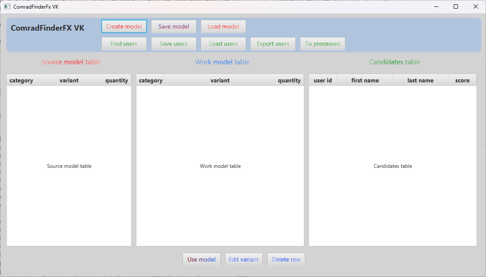

# ComradFinder FX

[](https://www.oracle.com/java/)
[](https://openjfx.io/)
[](https://maven.apache.org/)
[-yellow.svg)](-)

**ComradFinder** is a desktop prototype application designed to find potential like-minded individuals and enthusiasts of the HumanBuilding (HB) movement on social networks.

> ⚠️ **IMPORTANT NOTE ON CURRENT STATUS**  
> This repository contains a **legacy, highly specialized prototype**, initially created exclusively for the VKontakte (VK) social network.
>
> 1. **Outdated API:** The application uses an old version of the VK REST API (v4.5). For modern operation, it requires updating the API endpoints or transitioning to web scraping.
> 2. **Token Security:** In the current source code, the `access_token` value may be hardcoded. It is **strictly discouraged** to store tokens in compiled code. Before building and running, you must extract the token from the source code and implement a secure retrieval mechanism (e.g., via environment variables, a `.env` configuration file, or interactive input on first launch) and substitute it into the requests.

---

## 📸 Application Interface



---

## 🚀 Modernization Roadmap

The project requires serious updates to align with modern realities and the goals of HB-progressivism. We invite developers to join the refinement of this application. Here are the key areas for development:

- [ ] **Platform Expansion:** Implement a functional and compliant mechanism for finding like-minded individuals on Facebook (considering modern Meta APIs), optionally retaining VK support.
- [ ] **Decentralized Networks:** Add support for searching in federated and decentralized social networks, such as Mastodon (<https://mastodon.social>), as well as other suitable sources (e.g., Reddit, specialized forums) where progressive audiences concentrate.
- [ ] **Modern Selection Algorithms:** Improve the profile analysis technology by replacing simple keyword matching with modern approaches: Data Mining, Big Data analysis, and leveraging Large Language Models (LLMs) for semantic analysis of candidates' interests and worldviews. *(Note: the `jsoup` dependency is already added to `pom.xml` as a first step toward transitioning from API to HTML parsing).*
- [ ] **Platform Shift (Web):** Evaluate the feasibility of creating a modern web version of the application (e.g., React/Vue + Spring Boot/Node.js) instead of the desktop JavaFX version, to simplify access and ensure cross-platform compatibility.
- [ ] **Security & Performance:** Conduct a code audit, eliminate vulnerabilities (including updating dependencies), and optimize memory and network request handling.
- [ ] **New Features:** Brainstorm and implement missing features, such as result exporting, advanced filtering, candidate scoring systems, and integration with other HB-culture tools (e.g., CTFinder or MySkillsOrganizer).

---

## 🛠️ Technologies (Legacy Stack)

- **Language:** Java 8 (migration to Java 11/17+ is recommended during modernization)
- **UI:** JavaFX
- **Build:** Apache Maven
- **Parsing:** `jsoup` (included for future HTML parsing implementation instead of the outdated API)
- **Data:** `org.json`, `Apache POI` (for exporting), `stax-utils`

---

## ⚙️ How to Run the Current Version

1. Ensure you have JDK 8 (or higher) and Apache Maven installed.
2. **IMPORTANT:** Locate the part of the code where the `access_token` for the VK API is used, and replace the hardcoded value with a secure mechanism (e.g., reading from the `VK_TOKEN` environment variable).
3. Clone the repository:

   ```bash
   git clone https://github.com/YuriiTrofimenko/ComradFinderFX_VK_maven.git
   cd ComradFinderFX_VK_maven
   ```

4. Clean and compile the project:

   ```bash
   mvn clean compile
   ```

5. Run the application using the JavaFX plugin:

   ```bash
   mvn clean javafx:run
   ```

---

## 🤝 How to Contribute

This project is an open conceptual prototype. If you share the ideas of HumanBuilding and want to revive this tool:

1. **Fork** this repository.
2. Create a new branch for your feature (`git checkout -b feature/AmazingFeature`).
3. Make your changes and commit them (`git commit -m 'Add some AmazingFeature'`).
4. Push the changes to your fork (`git push origin feature/AmazingFeature`).
5. Open a **Pull Request** with a detailed description of your changes.

Anyone is welcome to contact the author for additional information, historical context, or access to old configurations to resume work on the project.

---

## 📜 Contacts

- **Author:** Yurii Trofimenko
- **Email:** <tyaa10@gmail.com>
- **Telegram:** [@YuriiTrofimenko](https://t.me/YuriiTrofimenko)
- **Personal VK:** [vk.com/yuriitrofimenko](https://vk.ru/yuriitrofimenko)
- **Personal FB:** [facebook.com/yuriitrofimenko1986](https://www.facebook.com/yuriitrofimenko1986)
- **HB Community VK:** [vk.com/humanbuilders](https://vk.ru/humanbuilders)
- **HB Community FB:** [facebook.com/groups/150758748845784](https://www.facebook.com/groups/150758748845784)

*This project was created with the hope that new enthusiasts will pick it up and develop it into a Minimum Viable Product (MVP) for the benefit of the global HB community.*
